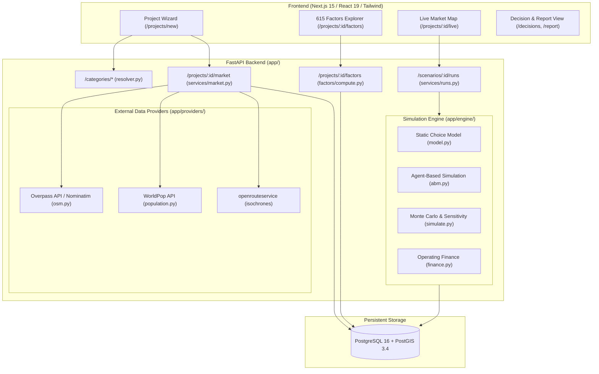

# StratIq Repository Audit: Phase 0 Scientific & Engineering Evaluation

**Audit Date:** October 31, 2026  
**Audited Head Commit:** `0883fb4` (`Docs: agent-based live market and factor engine`)  
**Previous Identified Revision:** `c03eb2f` / `bd9a283`  
**Repository Working Copy:** `C:\Users\Lenovo\OneDrive\Desktop\INNOTECH\StratIq`  
**Auditor:** Principal Software Architect, Computational Social Scientist & Research Review Team  

---

## Executive Summary

StratIq is an ambitious location feasibility and market intelligence system designed to answer the core business question: *"If I open a business at location $(x,y)$, what customer population, demand, competitor capture, and financial outcome are realistically expected?"*

The current codebase (at commit `0883fb4`) features a clean, well-tested Python/FastAPI backend, PostGIS spatial database, Next.js frontend, and a 615-factor registry. However, an exhaustive scientific and architectural audit reveals critical issues spanning:
1. **P0 Classification Flaws:** Fatal category resolution ties and lexical substring overlaps (e.g. `dentist clinic` resolving to `clinic` rather than `dentist`; `medical clinic` resolving to `pharmacy`; `orthodontist` falling back to keyword string matching). Furthermore, all competitors within a project are linked to `project_id` without category/service-level scoping, leading to cross-category pollution (such as spas appearing in dental clinic competitor lists).
2. **P0/P1 Uncalibrated Behavioural Parameters & "615 Genome" Conflation:** 291 of the 615 factors are classified as `UNSUPPORTED`. 193 have no data source connected (`role: reserved`), 109 are endogenous simulation outputs mistakenly classified as input factors, and 82 are hardcoded heuristic constants (such as $\beta_p = 1.0, \beta_q = 2.0$, outside option $U_0 = 0.0$, circuity = $1.3$, household size = $4.4$, and daily hazard formulas). None of the discrete-choice coefficients are estimated from revealed or stated preference data.
3. **P1 Synthetic Population Realism:** The current population engine downscales WorldPop 100m raster estimates to ~300m hexagonal cells using raw OSM building counts (dasymetric mapping). It lacks household structure, joint demographic cross-tabulations (income, car ownership, education), and Iterative Proportional Fitting (IPF) / Iterative Proportional Updating (IPU) against official Census margins.
4. **P1 Generic Appointment Economics:** A single generic `appointment` archetype groups dental clinics, hair salons, physiotherapists, and spas into an identical capacity formula ($\text{stations} \times \text{slots/station/day} \times \text{open days}$) with uniform 15% participation and 1.2 visits/month. Real dental economics requires service-specific modeling (consultations, cleanings, root canals, crowns, extractions, orthodontics) with differentiated equipment, staffing, duration, and margins.
5. **P2 Production Resilience:** Background data ingestion and Overpass scraping tasks are managed via unmonitored in-process `asyncio.create_task` sets, which fail silently upon process termination.

---

## 1. Complete Architecture & Tech Stack



### Module Responsibilities:
- `backend/app/categories/resolver.py`: Normalizes text queries and fuzzy-matches against `TAXONOMY`. Falls back to keyword matching or LLM selector grammar.
- `backend/app/categories/taxonomy.py`: Seed catalog of 50+ business types, OSM Overpass QL filters, and archetype assignments.
- `backend/app/categories/archetypes.py`: Defines 6 economic archetypes (`membership`, `dine_in`, `takeaway`, `retail`, `appointment`, `lodging`) with hardcoded default parameters and capacity formulas.
- `backend/app/factors/registry.py`: Canonical registry of 615 factor keys across 10 domains with metadata: scope, source, role, and description.
- `backend/app/factors/compute.py`: Gathers data from snapshot, scenario, simulation output, and user inputs to populate factor values.
- `backend/app/engine/model.py`: Multinomial/nested conditional logit choice model with segments, affordability filters, distance decay, and outside option utility.
- `backend/app/engine/abm.py`: 6,000 synthetic agent daily dynamic simulation over 84 days (awareness spread, habit formation, congestion penalty, churn).
- `backend/app/engine/simulate.py`: Orchestrates deterministic run, 800-draw Monte Carlo triangular sampling, and sensitivity sweeps.
- `backend/app/engine/finance.py`: Monthly operating economics (Revenue, Variable Costs, Contribution, Fixed Costs, Profit, Break-even, Payback).
- `backend/app/providers/osm.py`: Overpass QL building footprints, POIs, and Nominatim geocoding.
- `backend/app/providers/population.py`: WorldPop total population (`wpgppop`) and 17-band age-sex pyramid (`wpgpas`).
- `backend/app/services/market.py`: Hexagonal grid assembly, dasymetric population allocation, and coverage heuristics.
- `backend/app/services/runs.py`: Snapshot background generation and simulation execution.

---

## 2. Major Execution Flows Traced

### Execution Path A–M Summary:

1. **A. User Input:** User types query (e.g. `"dentist clinic"`).
2. **B. Category Resolution (`resolver.py`):**
   - Query normalized: `dentist clinic` -> tokens: `{"dentist", "clinic"}`.
   - Evaluated against `TAXONOMY`:
     - Entry `clinic` (index 88) matches synonym `"clinic"` -> Score: `0.92`.
     - Entry `dentist` (index 89) matches synonym `"dentist"` -> Score: `0.92`.
   - **TIE BREAKING BUG:** Python's stable sort preserves index order. `clinic` ranks above `dentist`. Score `0.92 >= 0.85`, so `needs_confirmation = False`.
   - Result: Project category assigned as `clinic` ("General clinic") instead of `dentist` ("Dental clinic").
3. **C. Provider Query (`osm.py`):**
   - Overpass query generated using `clinic` filters: `nwr["amenity"~"^(clinic|doctors)$"](around:...); nwr["healthcare"~"^(clinic|doctor)$"](around:...);`
   - Real dental clinics (`amenity=dentist`) are omitted; general outpatient dispensaries, ayurvedic clinics, and wellness spas tagged under healthcare are captured.
4. **D. Competitor Ingestion & Dedup (`market.py`, `runs.py`):**
   - Overpass POIs parsed, deduplicated by OSM ID (`ref`).
   - Saved to `competitors` table associated with `project_id`.
   - **BUG:** Unfiltered by service or taxonomy subtype. If the project category is subsequently edited or contains diverse health centers, irrelevant amenities persist in the active competitor set.
5. **E. Population Gathering (`population.py`):**
   - WorldPop API called asynchronously for catchment polygon.
   - If WorldPop times out, falls back to building footprint count $\times 12$ persons/building (`estimate_buildings`).
6. **F. Demand Zone Discretization (`market.py`):**
   - Catchment divided into regular hexagonal grid ($\sim 250\text{--}600\text{ m}$ spacing).
   - Dasymetric mapping distributes total catchment population proportionally to OSM building centroid counts per cell.
7. **G. Synthetic Population Sampling (`abm.py`):**
   - 6,000 synthetic records sampled from zones proportional to resident weights.
   - Person attributes assigned via pseudo-random draws:
     - Age from 17-band WorldPop pyramid or default Indian pyramid.
     - Sex from WorldPop male/female ratios.
     - Segment: 45% Budget, 40% Mainstream, 15% Premium.
     - Willingness to pay: $WTP_i = p_{ref} \cdot m_s \cdot \exp(\mathcal{N}(0, \sigma^2))$.
     - Digital adoption: $\text{Beta}(2.5, 2.0) \times \text{young factor}$.
     - Social susceptibility: $\text{Beta}(2.0, 2.5)$.
     - Loyalty: $\text{Beta}(2.0, 2.0)$.
     - Novelty seeking: $\text{Beta}(1.6, 2.4)$.
   - **SCIENTIFIC DEFECT:** Beta distributions and correlations are completely uncalibrated hypotheses rather than empirical copulas or factor models.
8. **H. Choice Probability Computation (`model.py`):**
   - Utility: $V_{zsj} = \beta_q(q_j - 0.5) - \beta_p k_s \ln(p_j / p_{ref}) - (\lambda / t_s) d_{zj} + \ln a_j$.
   - Affordability truncation: $F_{sj} = 1 - \Phi\left(\frac{\ln p_j - \ln(m_s p_{ref})}{\sigma}\right)$.
   - Outside option utility: $U_0 = 0.0$ default.
   - Choice probabilities: $P_{zsj} = \frac{F_{sj} \exp(V_{zsj})}{\exp(U_0) + \sum_k F_{sk} \exp(V_{zsk})}$.
9. **I. Static Demand & Capacity Bound:**
   - Total unconstrained demand: $D_0 = \sum_{z,s} N_{zs} P_{zs0} \times \text{frequency}$.
   - Constrained units: $Q_0 = \min(D_0, \text{Capacity})$.
10. **J. Dynamic Agent-Based Simulation (`abm.py`):**
    - 84 simulated days.
    - Daily awareness spread via paid advertising hazard, zone-level word-of-mouth pressure, and signage proximity.
    - Gumbel taste noise draws $\epsilon_{ij} \sim \text{Gumbel}(0, 0.6)$.
    - Turned-away customers store congestion memory for 14 days, reducing utility by $-1.0$.
11. **K. Financial Calculations (`finance.py`):**
    - $\text{Revenue} = p \times Q_0$.
    - $\text{Variable Costs} = v \times Q_0$ ($v = p \times \text{variable\_cost\_ratio}$ if unspecified).
    - $\text{Contribution} = \text{Revenue} - \text{Variable Costs}$.
    - $\text{Operating Profit} = \text{Contribution} - \text{Fixed Costs}$.
    - Excludes taxes, debt service, depreciation, and working capital.
12. **L. Factor Registry Assembly (`compute.py`):**
    - Assembles 615 factor values. Unconnected factors set to `status: unavailable` and `value: null`.
13. **M. Frontend Delivery:**
    - Serialized into JSON and rendered in Next.js dashboard, Factor table, and Live ABM map.

---

## 3. Comprehensive Table of Findings & Deficiencies

| ID | Finding | File/Function | Evidence | Severity | Proposed Correction |
|---|---|---|---|---|---|
| **F-01** | Category resolver score tie causes generic category to defeat specific subtype | `categories/resolver.py:rank_taxonomy` & `score_entry` | Query `"dentist clinic"` scores `0.92` for both `clinic` (line 88) and `dentist` (line 89). Python stable sort preserves `clinic`. | **P0** | Implement specificity-weighted scoring: prioritize multi-token exact matches, child-category depth penalties, and lexical hierarchy disambiguation. |
| **F-02** | Lexical overlap resolves "medical clinic" to "pharmacy" | `categories/resolver.py:score_entry` & `taxonomy.py` | Query `"medical clinic"` matches `"medical store"` synonym of `pharmacy` at index 64 with score `0.92`, defeating `clinic` at index 88. | **P0** | Disambiguate medical care from retail pharmaceutical shops. Require root semantic word alignment. |
| **F-03** | Lack of service-level competitor validation pollutes competitor sets (Dentist vs Spa) | `services/runs.py:competitors_for` & `services/market.py` | Query fetches all active POIs linked to `project_id` within radius without category/service filtering; OSM healthcare tags can include wellness/spa centers. | **P0** | Implement 6-tier competitor relationship classification (`direct`, `partial_service`, `indirect`, `adjacent`, `contextual`, `irrelevant`) with tag verification. |
| **F-04** | 193 "Reserved" parameters presented as part of factor engine without data | `factors/registry.py` & `compute.py` | 193 factors marked `role: reserved` have no connected data provider or econometric estimation. | **P1** | Explicitly label all 193 reserved factors as `UNSUPPORTED` in the evidence engine and prevent their inclusion in causal model inputs. |
| **F-05** | Conflation of endogenous simulation outputs with exogenous input parameters | `factors/registry.py` & `compute.py` | 109 factors marked `role: output` (e.g. `ops_revenue`, `ops_operating_profit`, `cmp_hhi`) registered alongside inputs in 615 factor genome. | **P1** | Architecturally separate input parameter registry from output simulation metrics. Never treat model outputs as explanatory agent attributes. |
| **F-06** | Discrete choice coefficients are hardcoded assumptions without empirical estimation | `categories/archetypes.py:_common` & `engine/model.py` | $\beta_p = 1.0, \beta_q = 2.0, \lambda \in [0.55, 1.0], U_0 = 0.0$ are hand-assigned constants labeled as `assumption`. | **P1** | Empirically estimate conditional logit and mixed logit coefficients using revealed/stated preference survey data with statsmodels / Biogeme / SciPy. |
| **F-07** | Generic appointment archetype forces identical economics across disparate industries | `categories/archetypes.py:ARCHETYPES["appointment"]` | Dental clinics, hair salons, and spas all share the same generic capacity ($\text{stations} \times \text{slots} \times \text{days}$) and uniform participation. | **P1** | Develop dedicated domain-specific economic models. For dental: model consultations, cleaning, fillings, root canals, and surgery with distinct durations, margins, and repeat rates. |
| **F-08** | Synthetic agent traits generated via arbitrary uncalibrated Beta/Gamma distributions | `engine/abm.py:run_abm` | Agent traits (digital adoption, novelty, loyalty, social influence) drawn from uncalibrated distributions: $\text{Beta}(2.5, 2.0)$, $\text{Beta}(2.0, 2.5)$. | **P1** | Replace arbitrary univariate beta generators with survey-constrained copulas or multidimensional representative weights calibrated against survey microdata. |
| **F-09** | Straight-line distance with constant circuity heuristic replaces network routing | `engine/model.py:build_arrays` & `factors/compute.py` | Haversine distance multiplied by constant $1.3$ circuity floor at $0.15\text{ km}$, ignoring physical barriers and network topology. | **P1** | Integrate network-based travel time matrices using OpenRouteService or local PostGIS pgRouting. |
| **F-10** | In-process background tasks lack durability across restarts | `services/runs.py:start_refresh` | Uses `asyncio.create_task(_refresh_job(...))` held in memory set `_background`. If process restarts, task dies and leaves snapshot stuck in loading until 5-min timeout. | **P2** | Implement durable background job processing with clear lifecycle states, retries, and persistence. |
| **F-11** | Straightforward ternary income segmentation without local distribution fitting | `categories/archetypes.py:_SEG_STD` | All markets assume exactly 45% budget, 40% mainstream, 15% premium with static WTP multipliers ($0.75, 1.05, 1.7$). | **P2** | Calibrate local income/expenditure distributions using National Sample Survey (NSSO / MoSPI HCES) deciles and District GDP proxies. |
| **F-12** | Database tests skipped in local environment due to missing default test database | `tests/test_api.py` | 5 integration tests skipped when `DATABASE_URL` is not set; test suite relies on mock monkeypatching for provider tests. | **P2** | Implement SQLite/PostGIS test container fixture or automated in-memory test database runner for complete local CI pass. |

---

## 4. Current Test Suite Audit

Running `pytest -rs -v` on the repository yields:
- **Total collected items:** 36
- **Passed:** 27
- **Skipped:** 9
  - 5 tests skipped in `tests/test_api.py` because `DATABASE_URL` is not configured locally.
  - 4 tests skipped in `tests/test_live.py` because `RUN_LIVE=1` is disabled to prevent hitting rate-limited external APIs (Overpass, WorldPop, Nominatim).

### What Existing Tests Actually Prove:
1. `test_engine.py` (14 tests): Proves internal mathematical consistency under assumed parameter ranges:
   - Proves choice probabilities are bounded in $[0, 1)$ and sum to $\le 1$.
   - Proves higher price decreases demand ceteris paribus under monotonic logit utility.
   - Proves capacity constraint binds when unconstrained demand exceeds threshold.
   - Proves Monte Carlo draws are reproducible when seed is fixed.
   - **DOES NOT PROVE:** Empirical validity, out-of-sample predictive accuracy, or correctness against real business footfall/sales.
2. `test_factors.py` (4 tests):
   - Proves the registry contains exactly 615 factor definitions across 10 domains.
   - Proves factor values do not invent values for reserved factors.
   - Proves ABM produces reproducible agent rows when seeded.
   - **DOES NOT PROVE:** That simulated factor values reflect real-world demographic or market conditions.
3. `test_market.py` (9 tests):
   - Proves OSM Overpass JSON parser extracts coordinates and strips personal contributor metadata.
   - Proves dasymetric population allocation sums to total catchment population.
   - Proves coverage heuristics classify low/good coverage based on building density.
   - **DOES NOT PROVE:** That OSM Overpass successfully retrieves all commercial competitors in dense Indian urban wards.

---

## 5. Architectural Gap Analysis Against Target Requirements

```
Current Architecture                                  Target Evidence-Driven Architecture
--------------------                                  -----------------------------------
Arbitrary 615 Factor Mix           --->               Rigorous 5-Class Parameter Registry
(Conflating Inputs & Outputs)                         (Observed, Derived, Estimated, Proxy, Unsupported)

Heuristic Archetype Appointment     --->               Service-Specific Economic Models
(Uniform stations * slots)                            (Dental: 7 distinct procedures, duration, costs)

Tie-prone Substring Resolver       --->               Hierarchical Taxonomy & Competitor Graph
("dentist clinic" -> "clinic")                        (Multi-token phrase scoring, 6-tier competitor relation)

Uncalibrated Behavioural Defaults  --->               Empirically Estimated Choice Models
(Fixed beta_p, beta_q, lambda)                        (Conditional & Mixed Logit on revealed choice data)

Pure Dasymetric Hex Downscaling    --->               Spatial Microsimulation / IPF Population
(Raster / building centroids)                         (Person & Household marginal constraints, Census alignment)

In-Process Asyncio Job Tasks       --->               Durable Asynchronous Job Execution
(Memory-bound, lost on restart)                       (Persistent job queue, retries, idempotent recovery)
```

---

## 6. Phase 0 Recommendation & Next Steps

1. **Gate 1 (Category & Competitor Correctness):** Immediately overhaul `resolver.py` and `taxonomy.py` with hierarchical specificity scoring and explicit dental classification regression tests. Implement competitor relationship filters to eliminate cross-domain noise.
2. **Gate 2 (Parameter Evidence Integrity):** Adopt `docs/research/PARAMETER_EVIDENCE_AUDIT.csv` as the canonical registry. Enforce strict isolation between exogenous inputs, empirical parameters, and endogenous outputs.
3. **Gate 3 (Synthetic Population):** Implement spatial microsimulation using IPF/IPU algorithms to generate representative, weighted synthetic agents calibrated against official demographic margins.
4. **Gate 4 (Discrete Choice Calibration):** Structure choice model coefficient estimation with McFadden conditional logit baselines and outside option estimation.
5. **Gate 5 (Dental Economics):** Build a procedure-level dental feasibility model with realistic clinical capacities, equipment capex, chair utilization, and procedure unit margins.
